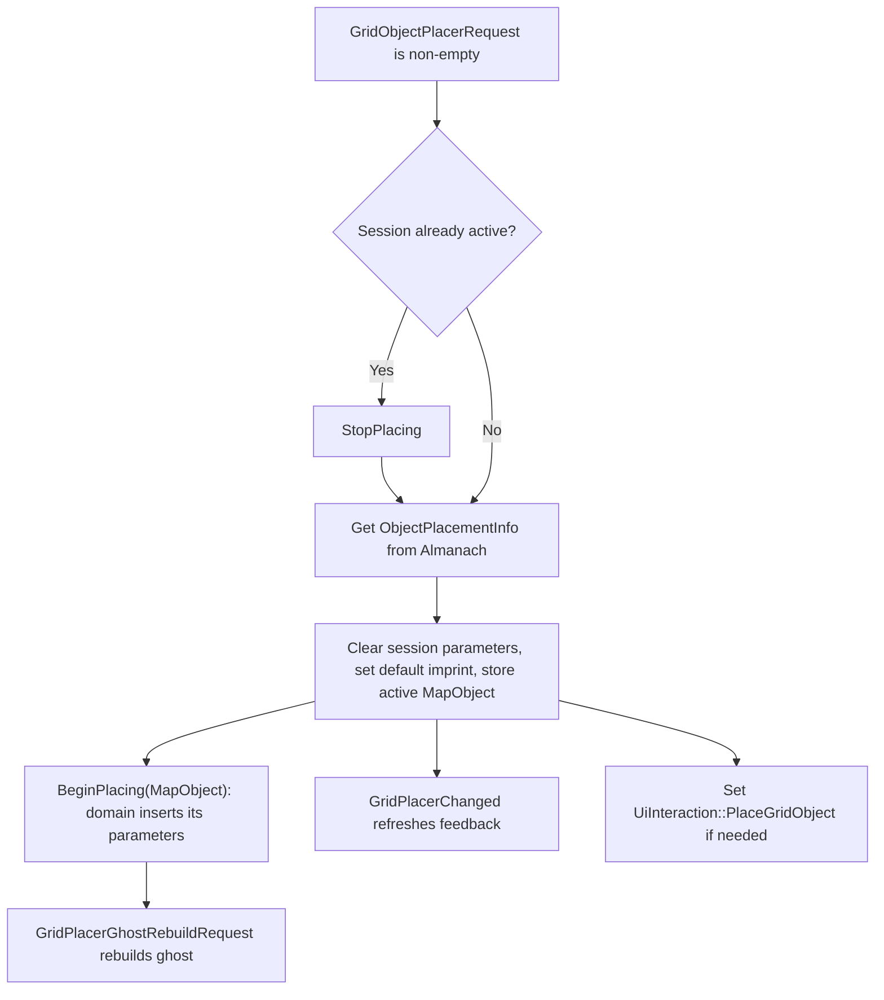
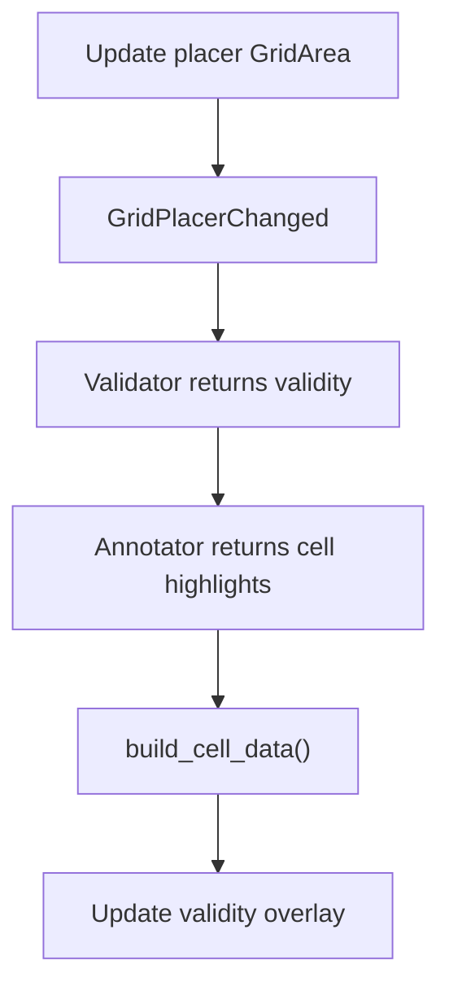
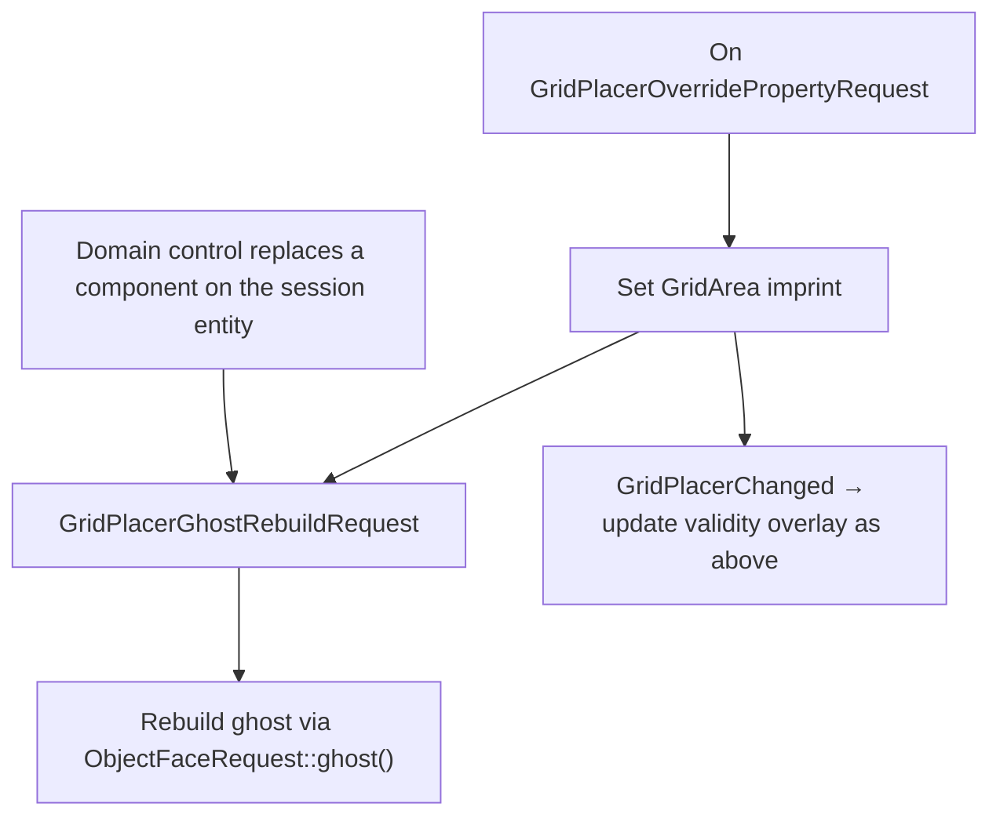
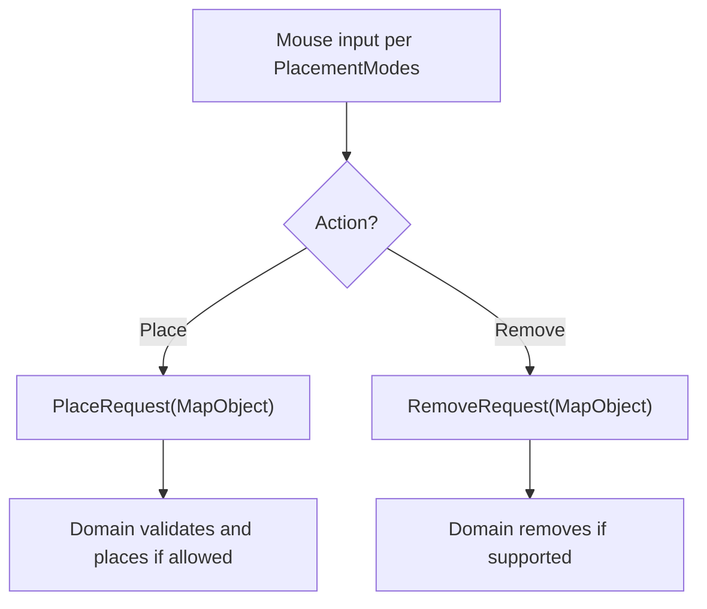
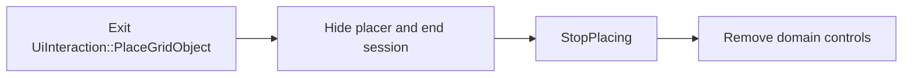

# Grid Object Placer

The grid object placer lets players place and remove objects on the map grid. It follows the cursor, shows a preview and placement feedback, and sends requests when the player clicks.

## How it works

1. **Select:** UI or keyboard input selects a `MapObject`. The placer gets its placement settings from the Almanach and starts a session.
2. **Preview:** A ghost follows the cursor, and an overlay shows placement validity. Domain controls can change the footprint or object-specific settings, such as wall style and tunnel openings.
3. **Act:** A click sends `PlaceRequest` or `RemoveRequest`. The object's domain decides whether to place or remove it.
4. **End:** Switching objects or leaving placement ends the session and removes its controls.

## Integration contracts

### `GridObjectPlacerRequest`

A resource. Set it from UI or keyboard input to start or switch placement:

```rust
grid_object_placer_request.set(MapObject::Wall);
```

### `ObjectPlacementInfo`

Each placeable `MapObject` registers its placement settings through `AlmanachAppExt`. The placer retrieves those settings from `Almanach` when a session begins.

```rust
pub struct ObjectPlacementInfo {
    pub imprint: GridImprint,           // Default imprint
    pub validate: PlacementValidatorFn, // Placement validity
    pub annotate: PlacementAnnotatorFn, // Per-cell highlights
    pub placement: PlacementModes,      // Place/remove behavior
}
```

### `PlaceRequest` / `RemoveRequest`

The placer emits these events on mouse input, according to the object's `PlacementModes`. Domain handlers match the object type, validate the request, and apply it.

For example, the wall placement handler reads `GridArea` from the placer and `WallStyleKey` and `WallShape` from the session entity:

```rust
let PlaceRequest(MapObject::Wall) = *trigger else { return };
let area = placer.into_inner();
let (style, shape) = placer_session.into_inner();
if (almanach.walls.validate)(MapObject::Wall, *area, &grids) == PlacementValidity::Invalid { return; }
commands.spawn(BuilderWall::new(area.origin, *style).with_shape(*shape));
grids.reserved_coords.reserve(*area);
```

The reservation prevents overlapping placement requests before the deferred spawn updates the obstacle grid.

### `GridPlacerSession`

Marks a child of the placer that stores parameters for the active object's domain. Wall placement, for example, stores `WallStyleKey` and `WallShape` here. Reusing the components carried by placed objects keeps these settings in the domain's API.

The entity persists across sessions. Before each `BeginPlacing`, the placer removes all its components except `GridPlacerSession` and `ChildOf`, clearing the previous settings while preserving the parent relationship.

### `BeginPlacing` / `StopPlacing`

These events mark the start and end of a placement session. On `BeginPlacing`, initialize domain parameters on the session entity and create any controls:

```rust
let BeginPlacing(MapObject::Wall) = *trigger else { return };
commands.entity(*placer_session).insert((WallStyleKey::default(), WallShape::default()));
commands.spawn(GridPlacerUiForWall);
```

The placer builds the ghost after `BeginPlacing` observers have initialized the parameters, so the preview renderer can read them.

On `StopPlacing`, remove the domain's controls. Switching objects or leaving placement ends the session; changing settings within it does not emit either event.

### `GridPlacerOverridePropertyRequest`

Overrides a placer setting for the active session. The supported override is `Imprint(GridImprint)`, which changes the object's footprint. For example, a quantum field's size selector sends:

```rust
commands.trigger(GridPlacerOverridePropertyRequest::Imprint(imprint));
```

The override rebuilds the ghost and refreshes placement validity and cell highlights. Starting a new session restores the object's default imprint.

### `GridPlacerGhostRebuildRequest`

Replaces the ghost with a new preview. Domain controls send this request after updating their parameters on the session entity:

```rust
commands.entity(*placer_session).insert(selected_style);
commands.trigger(GridPlacerGhostRebuildRequest);
```

This request does not refresh placement validity or cell highlights. Validation callbacks receive the object, its area, and spatial indexes; they do not read the session entity.

### `ObjectFaceRequest`

After creating the ghost, the placer sends it `ObjectFaceRequest::ghost`. The preview renderer reads `GridImprint` from the ghost and object-specific parameters from the session entity.

### `GridPlacerChanged`

Requests a refresh of placement validity and cell highlights. The placer emits it when the cursor enters another cell, the imprint is overridden, or a session begins.

## Flows

### Starting a session



### While the session is active

**Cursor moves to another grid cell**



**Imprint override or domain parameter change**



**Mouse input**



For deferred spawns, `ReservedCoords` prevents another placement from using the same cells before the obstacle grid updates. Reservations clear at the start of the next frame.

**Leaving placement**



## Adding a placeable object

1. Add its variant to `MapObject` (`game_core/src/types.rs`).
2. Register placement settings via `AlmanachAppExt`, convert the domain info to `ObjectPlacementInfo`, and extend `Almanach::get_placement_info_for`.
3. Observe `PlaceRequest` and, if supported, `RemoveRequest`; match the variant and validate before acting.
4. Handle `ObjectFaceRequest` for the ghost and any other supported surfaces.
5. If the object has configurable settings, initialize them on the session entity and create controls on `BeginPlacing`. Remove the controls on `StopPlacing`.
6. Have those controls send `GridPlacerOverridePropertyRequest::Imprint` for footprint changes. For domain settings, update the session components and send `GridPlacerGhostRebuildRequest`.
7. Handle `MapObjectTooltipRequest` and add a menu offering if the object belongs in the side menu.

The placement code is split across three modules:

- [`grids/src/placement.rs`](../../grids/src/placement.rs): shared events, input modes, and reservations.
- [`indexes/src/placement.rs`](../../indexes/src/placement.rs): placer state, the session marker, validation callbacks, and cell highlight callbacks.
- [`indexes_internal/src/placement.rs`](../../indexes_internal/src/placement.rs): placement systems and observers.
