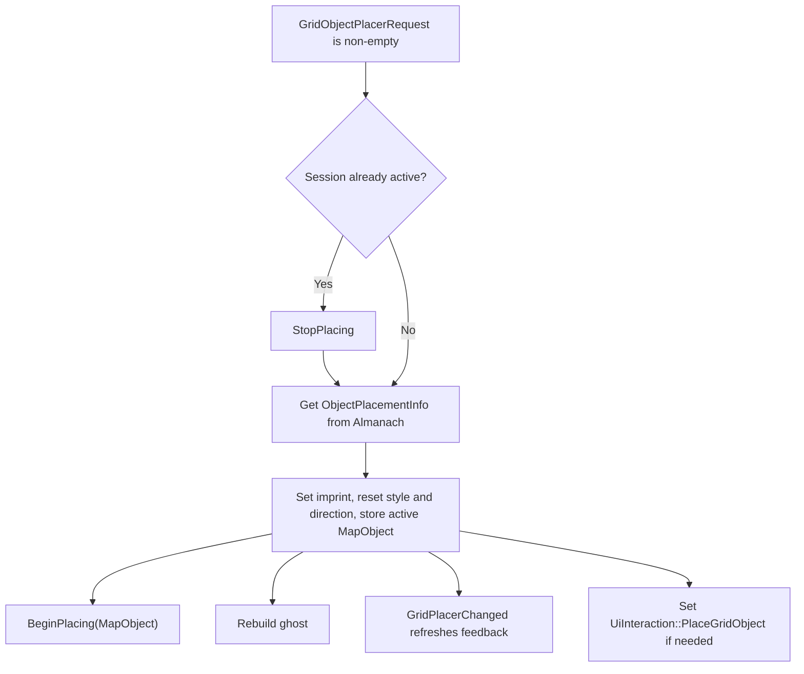
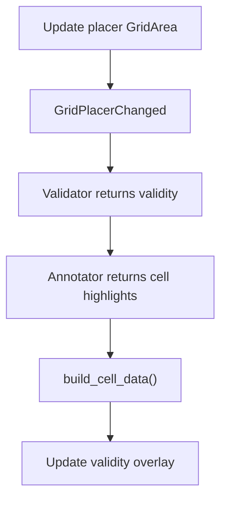
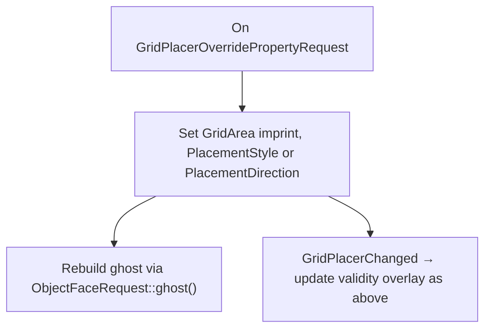
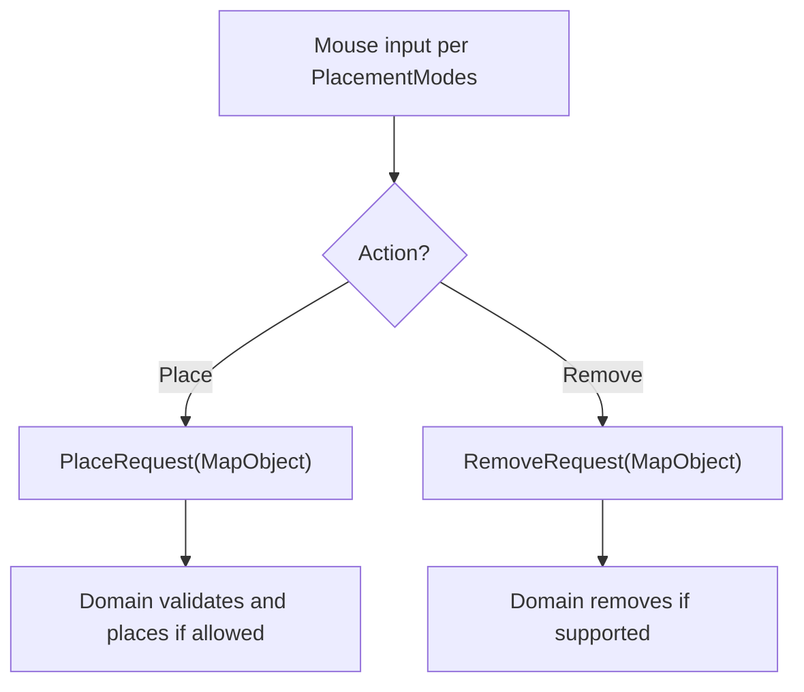

# Grid Object Placer

The grid object placer lets players place and remove objects on the map grid. It follows the cursor, shows a preview and placement feedback, and sends requests when the player clicks.

## How it works

1. **Select:** UI or keyboard input selects a `MapObject`. The placer gets its placement settings from the Almanach and starts a session.
2. **Preview:** The placer follows the cursor. A ghost shows the object; an overlay shows where it can be placed. Domain controls can change its imprint, style, or direction.
3. **Act:** A click sends `PlaceRequest` or `RemoveRequest`. The object's domain decides whether to place or remove it.
4. **End:** Switching objects or leaving placement ends the session and removes its controls.

## Integration contracts

### `GridObjectPlacerRequest`

A resource. Set it from UI or keyboard input to start or switch placement:

```rust
grid_object_placer_request.set(MapObject::Wall);
```

### `ObjectPlacementInfo`

Each placeable `MapObject` registers its placement settings through `AlmanachAppExt`. The placer retrieves those settings from `Almanach` when a session begins.

```rust
pub struct ObjectPlacementInfo {
    pub imprint: GridImprint,           // Default imprint
    pub validate: PlacementValidatorFn, // Placement validity
    pub annotate: PlacementAnnotatorFn, // Per-cell highlights
    pub placement: PlacementModes,      // Place/remove behavior
}
```

### `PlaceRequest` / `RemoveRequest`

The placer emits these events on mouse input, according to the object's `PlacementModes`. Domain handlers match the object type, validate the request, and apply it.

For example, the wall placement handler reads `GridArea`, `PlacementStyle`, and `PlacementDirection` from the placer:

```rust
let PlaceRequest(MapObject::Wall) = *trigger else { return };
let (area, style, direction) = placer.into_inner();
if (almanach.walls.validate)(MapObject::Wall, *area, &grids) == PlacementValidity::Invalid { return; }
commands.spawn(BuilderWall::new(area.origin, *style).with_ramp_high_side(direction.0));
grids.reserved_coords.reserve(*area);
```

The reservation prevents overlapping placement requests before the deferred spawn updates the obstacle grid.

### `BeginPlacing` / `StopPlacing`

Emitted at the beginning and end of a placement session. Use them to create and remove controls such as the wall style picker or quantum-field size selector. Property changes within a session do not emit these events.

```rust
let BeginPlacing(MapObject::Wall) = *trigger else { return };
commands.spawn(GridPlacerUiForWall);
```

### `GridPlacerOverridePropertyRequest`

Requests a property change within the active session. Domain controls send these events when the player selects an imprint, style, or direction.

```rust
commands.trigger(GridPlacerOverridePropertyRequest::Style(selected.0));
```

Available overrides:

- `Imprint(GridImprint)` — change the object's footprint.
- `Style(u8)` — select a variant interpreted by the object's domain.
- `Direction(Option<EdgeSide>)` — set or clear a direction interpreted by the object's domain. For walls, this is the ramp's high side; `None` selects a flat wall.

Each override rebuilds the ghost and refreshes placement feedback. A new session restores the object's default imprint, sets style to `0`, and clears direction.

### `ObjectFaceRequest`

The placer sends `ObjectFaceRequest::ghost` to the ghost entity after creating it. The entity carries `GridImprint`, `PlacementStyle`, and `PlacementDirection`; the object's domain reads them to render the preview.

### `GridPlacerChanged`

Requests a refresh of placement validity and cell highlights. The placer emits it when the cursor enters another cell, a property changes, or a session begins.

## Flows

### Starting a session



### While the session is active

**Cursor moves to another grid cell**



**Imprint, style or direction override**



**Mouse input**



For deferred spawns, `ReservedCoords` prevents another placement from using the same cells before the obstacle grid updates. Reservations clear at the start of the next frame.

**Leaving placement**


## Adding a placeable object

1. Add its variant to `MapObject` (`game_core/src/types.rs`).
2. Register placement settings via `AlmanachAppExt`, convert the domain info to `ObjectPlacementInfo`, and extend `Almanach::get_placement_info_for`.
3. Observe `PlaceRequest` and, if supported, `RemoveRequest`; match the variant and validate before acting.
4. Handle `ObjectFaceRequest` for the ghost and any other supported surfaces.
5. If needed, create controls on `BeginPlacing`, remove them on `StopPlacing`, and send imprint, style, or direction overrides.
6. Handle `MapObjectTooltipRequest` and add the appropriate menu offering, if the object is offered in the side menu.

The placement code is split across three modules:

- [`grids/src/placement.rs`](../../grids/src/placement.rs): shared events, input modes, style and direction selections, and reservations.
- [`indexes/src/placement.rs`](../../indexes/src/placement.rs): placer state, validation callbacks, and cell highlight callbacks.
- [`indexes_internal/src/placement.rs`](../../indexes_internal/src/placement.rs): placement systems and observers.
